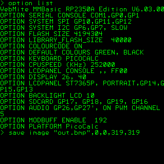

# picocalc-mixed-nuts
An assortment of various programs written for the ClockworkPi PicoCalc! (MMBASIC)
I also am keeping track of all my other picocalc projects here. 

**My System:**
- Clockwork Pi's PicoCalc (got here: https://www.clockworkpi.com/picocalc)
- Raspberry Pi Pico 2W (got here: https://www.pishop.ca/product/raspberry-pi-pico-2w-with-header)
- 32GB SD Card as 'Drive B:'
- Currently Running: WebMite MMBasic RP350A Edition V6.03.00 (got it here: https://geoffg.net/picomite.html // & also here: https://github.com/UKTailwind/PicoMite/releases/tag/PicoMite-V6.03.00)

**My System Options/Settings:**

**Hardware Modifications:** (In Planning Phases, nothing completed yet and parts still unpurchased)
  - Add an RTC (probably this one https://www.amazon.ca/Mixse-DS3231-AT24C32-Precision-Arduino/dp/B076QH37SL/)
  - add a LORA module (unsure, maybe Heltec v4 w/out screen? number of ideas here https://forum.clockworkpi.com/t/picocalc-with-lora/16773)
  - add some LEDs (maybe like this? https://www.youtube.com/watch?v=QOgxWYAiX9A)
  - add an IR Transmitter/Receiver (so i can interface with my Tamagotchi Connect from 2004! info here https://github.com/zacharesmer/tamagometer)
  - add a Temp/Humidity sensor (webmite and picomite have built in firmware support for a 'DHT22/AM2302 Digital Temperature and Humidity Sensor Module')
  - get PicoPac printed @ library or by a friend (https://www.thingiverse.com/thing:7105099/)
  - get Storage Cell printed @ library or by a friend (https://www.printables.com/model/1409767-picocalc-storage-cell)
  - get this cover (https://www.printables.com/model/1360903-two-way-cover-for-picocalc-by-clockwork-pi) or this one (https://github.com/philosiraptor/pico-calc-cover/tree/main) printed @ library or by a friend

**My Work Setup:**
- MMEdit (got here: https://geoffg.net/mmedit.html /// barely used, typically just use the in-built code editor in Webmite so far)
- PuTTY Terminal Emulator (got here: https://www.chiark.greenend.org.uk/~sgtatham/putty/)

**MOG1.BAS (v0.01 - The 'Direct' Port)**

> This is a quick and dirty port of my old unfinished text adventure from the Ti-83 Plus Graphing Calculator.
The program was originally written in TI-BASIC 83, so the structure of this program is a bit different now that it's in MMBasic.
Examples I can think of: Lack of the Menu(Option,Goto) function, Lack of the STO key used for storing variables, Loops are written different in MMBasic, 
using Print instead of using Output(X,Y,str), etc. 
I plan to add to the game now that I've got this basic archival version, and maybe will make a simulation for the Menu() command, we'll see. 

**RANDINT.BAS**
> Subroutine to mimic python's randint(x,y) command. Saved to my Library.

**ROLLFUNC.BAS**
> Function to minic my python 'roll' function. Uses randint. Saved to my Library.

**STARTUP.BAS**
> An incomplete startup script. I plan to add RTC functionality to my PicoCalc so I'll be doing some time related commands here in the future, will prolly make it into a sub (mm.startup) when complete and save to library - for now it lives on SD Card only as a test program.

**SAVETHROW.BAS**
> Just a data file of all OSE save-throw tables for future use in my B/X D&D simulation programs. All from the free SRD, all rights go to Necrotic Gnome on the numbers if thats necessary.
